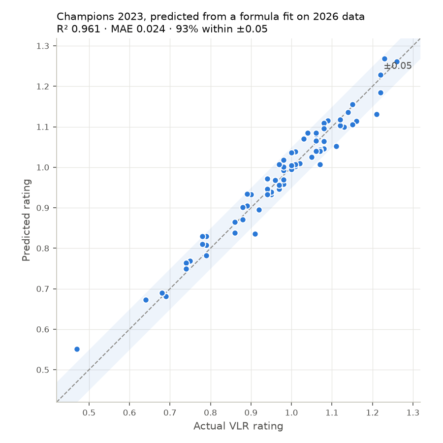

# Reverse-Engineering the VLR.gg Player Rating

[VLR.gg](https://www.vlr.gg) is the main stats site for professional Valorant. Its headline number,
**Rating 2.0**, ranks every pro player, but the formula behind it has never been published.

This project tries to recover that formula from public data. It scrapes VLR's stats tables, builds
features from the raw box-score stats, and fits linear models that predict a player's rating from those
stats.

**Result:** a formula fit on 2026 matches predicts **Valorant Champions 2023** ratings with R² = 0.96.
Champions 2023 was played three years earlier, and the two datasets share no matches. Mean error is
0.024, and **93% of players land within ±0.05** of their real rating. That is about 5× better than a
predict-the-mean baseline.



## Recovered formula

Fit on all-time VCT stats (717 players, min. 1000 rounds):

```
Rating ≈ 0.612
       + 0.961 × KPR      (kills per round)
       + 0.157 × APR      (assists per round)
       − 0.955 × DPR      (deaths per round)
       + 0.0022 × ADRa    (damage per round not explained by kills)
       + 0.372 × KAST     (fraction of rounds with a kill, assist, survival or trade)
```

`analyze_data.py` writes the latest fit to `data/formula.json`, and `check_formula.py` reads it from
there, so the two never drift apart.

## Results

| Model | 10-fold CV R² (all-time) | Holdout R² | Holdout MAE | Within ±0.05 |
|---|---|---|---|---|
| Linear regression, 5 features | 0.912 ± 0.019 | 0.961 | 0.024 | 93% |
| Constrained, 5 features | 0.912 ± 0.019 | 0.963 | 0.023 | 93% |
| Linear regression, + first kills/deaths | 0.917 ± 0.017 | 0.966 | 0.022 | 93% |
| Baseline: always predict the mean | — | — | 0.117 | — |

*Holdout:* the model is trained on the last 90 days of VCT (219 players) and tested on Champions 2023
(74 players).

VLR displays ratings rounded to 0.01, so part of the remaining error comes from rounding in the target.

## How it works

```
vlr.gg stats pages ──► scrape_data.py ──► data/raw/*.csv
                                              │
                                     clean_data.py  (parse %, derive DPR/ADRa,
                                              │      drop incomplete-data players)
                                              ▼
                                       data/clean/*.csv
                                              │
                                     analyze_data.py  (OLS vs. bound-constrained
                                              │        least squares, CV + holdout)
                                              ▼
                              data/formula.json + docs/predicted_vs_actual.png
```

1. **Scraping** (`src/scraping/scrape_data.py`). VLR's site needed three workarounds:
   - **Cookie gate.** On the first visit, `/stats` sets a cookie and redirects to bare `/stats`,
     dropping the query string. Unless a session primes the cookie first, every filtered request
     quietly returns the same default table.
   - **Changed filter parameters.** The filters are now `span`/`tier`/`min_rounds`, and VLR silently
     ignores parameters it doesn't recognize. The scraper uses the current names.
   - **Pagination.** Results come 100 per page, and the scraper follows the pager. Cells are read by
     their `data-col` attribute, not their position, so new or reordered columns don't break parsing.
2. **Cleaning and feature engineering** (`src/scraping/clean_data.py`):
   - `DPR = deaths / rounds`
   - `ADRa = (ADR·rounds − 140·kills) / rounds`. This is damage left over after removing roughly
     140 HP per kill, so damage and kills don't double-count each other.
   - **Data-quality filter.** Some matches have incomplete round data (mostly the 2023 China league),
     so VLR's first-kill count contradicts its own FK%. Those players' ratings don't follow the usual
     formula either: in the 2023 season, their average residual was 2.5× everyone else's. Dropping
     players where the two numbers disagree by more than 2 points raised season-2023 R² from 0.88 to
     0.94.
3. **Modeling** (`src/analysis/analyze_data.py`): compares two models.
   - A plain linear regression (scikit-learn).
   - A **bound-constrained least-squares** fit (`scipy.optimize.lsq_linear`). It encodes what is known
     about VLR's rating update: assists and KAST count for less than in the original rating, KAST
     stays positive, and deaths hurt.

   Evaluation uses shuffled k-fold CV plus an out-of-time holdout. VLR's tables are sorted by rating,
   so an unshuffled split gives each fold a narrow rating band and produces a meaningless negative R².
4. **Validation** (`src/analysis/check_formula.py`): applies the saved formula to any dataset or list
   of players and prints actual vs. predicted rating for each one.

## Findings

- **Kills and deaths are mirror images.** Across every dataset, KPR ≈ +1.0 and DPR ≈ −1.0. The rating
  rewards net kills per round more than anything else.
- **Survival rate can't be used as a feature.** `SR = (rounds − deaths) / rounds = 1 − DPR` exactly,
  so it is perfectly collinear with deaths. A regression can only split one effect between the two
  arbitrarily (earlier runs gave ±0.545), so SR is left out.
- **KAST can't be pinned down on its own.** Its coefficient ranges from −0.22 to +0.37 depending on the
  dataset, while KPR and DPR barely move. KAST mostly overlaps with kills, assists and deaths, so the
  data can't separate its own effect. This is the case the constrained model exists for: bounding
  KAST to [0, 0.313] costs nothing in accuracy and keeps its coefficient sensible.
- **Damage matters a little beyond kills.** ADRa adds about +0.02 rating per 10 extra damage per round.
- **Dying first costs extra.** Adding first deaths per round gives FDPR a coefficient of −0.39 on top
  of ordinary deaths. VLR appears to treat dying first in a round as worse than dying later.
- **The formula has stayed stable over time.** Coefficients fit on 2026 data predict 2023 ratings with
  R² 0.96, so VLR doesn't seem to have changed the rating formula in that period.

## Running it

```bash
pip install -r requirements.txt
python src/scraping/scrape_data.py     # optional: refresh data/raw from vlr.gg (~15 requests)
python src/scraping/clean_data.py
python src/analysis/analyze_data.py
python src/analysis/check_formula.py                                     # all Champions 2023 players
python src/analysis/check_formula.py data/clean/stats_recent.csv aspas   # specific players
```

Run the scripts from the repository root. Paths are relative to it.

## Limitations and next steps

- VLR shows ratings rounded to two decimals, which limits how precisely the formula can be recovered.
- A player's stats are averaged over their whole sample. VLR likely computes rating per round or per
  map and then averages, which a linear model on aggregates can only approximate. Per-map scraping
  would test this directly.
- Possible next steps: nonlinear terms (e.g. trade kills or multi-kills, which VLR doesn't show in its
  stats tables) and weighting players by rounds played.

## Credits

This project builds on an earlier VLR rating analysis by **Mark Zhdan**, whose original scraper,
cleaning step and constrained-regression approach I used as a starting point. I refactored it to match
VLR.gg's current site and data. That meant rewriting the scraper for the cookie gate, the new filters
and pagination, adding the data-quality filter, and redesigning the evaluation and the formula
pipeline.
